# Kyujin Bot: screenshots for Discord's privileged intent review

Kyujin Bot (application ID 1532200649930833920) is a private bot that runs
only in kpopfriends (KPF) and its owner's private server.
Privacy policy: https://gist.github.com/greatgreatasset/50a503f2edc75b1e12e856678e239d77

## Message Content intent

### 1. Archive viewer: a deleted message kept in the moderation log
The read-only viewer on the owner's PC (localhost). The message was deleted
on Discord; the archive keeps it with a "deleted" marker so a reported post
can still be reviewed.

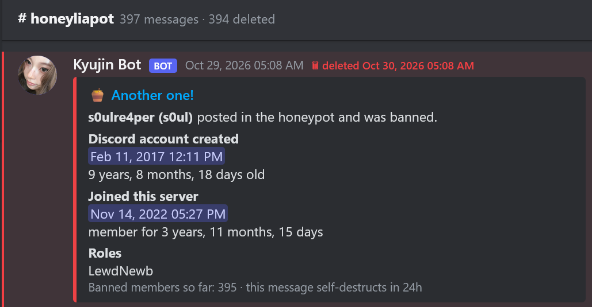

### 2. Archive viewer: edit history of a message
Every edit is kept, so what a post said when it was reported can be checked.

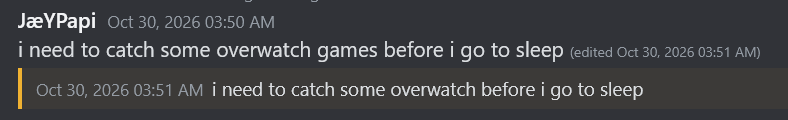

### 3. Delete alert DM (owner's private server)
When a message is deleted on the private server, the bot DMs the owner the
archived text. This needs the message content.

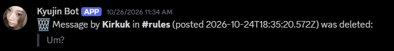

### 4. Honeypot: anti-spam
The hidden honeypot channel's status message (banned compromised accounts
so far) and a catch announcement. The archive is used to clean up the spam.

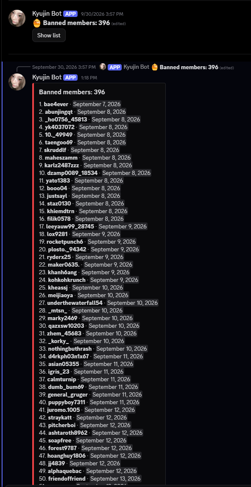

### 5. Media relay: the #kpopfriends post
A member's post in KPF's #kpopfriends tagging an idol ping role.

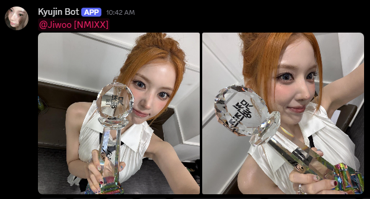

### 6. Media relay: the copy in the private server, with review buttons
The same post relayed by webhook to the matching channel in the owner's
private server, with the Approve / Delete / Always approve / Ignore buttons.
Copying it needs the post's links (content) and attachments.

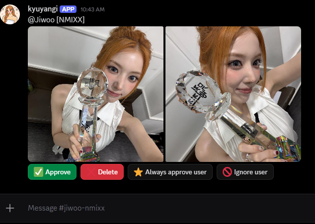

### 7. Link card for an X/Twitter link posted in chat
The bot has to see the link in the message to reply with the post's text,
media and counts.

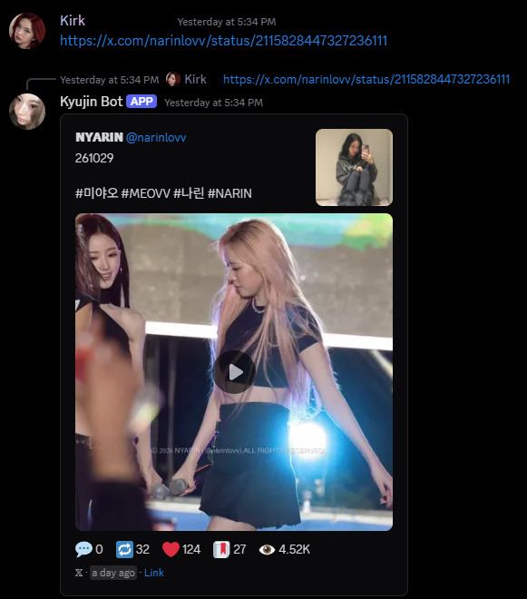

## Server Members intent

### 8. The rank role ladder
Server Settings → Roles: the 12 stacking rank roles, with the base role
(LewdNewb) that every member is meant to hold from the moment they join.

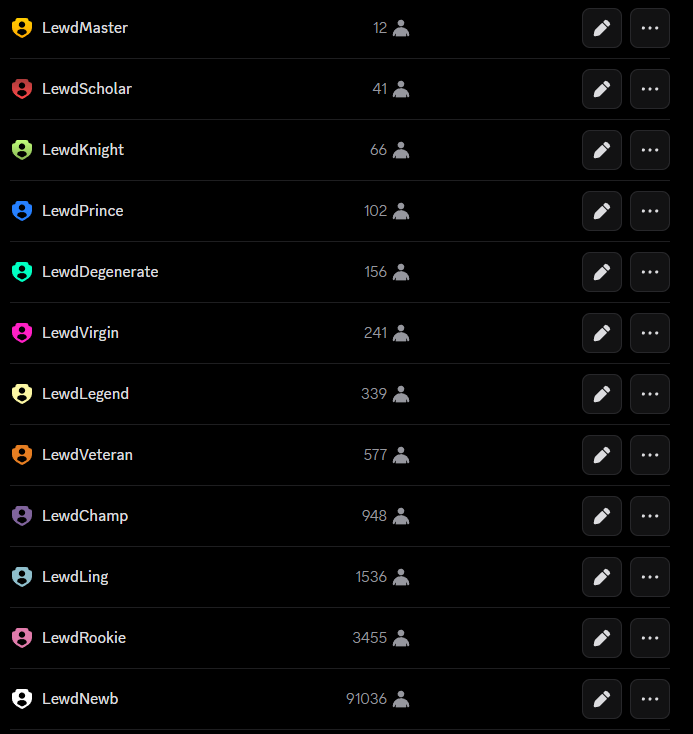

### 9. Audit log: Kyujin Bot gives the base role
"Kyujin Bot added the role LewdNewb" with reason "New member". Today this
can only happen when the member first posts; with the Server Members intent
it happens on join.

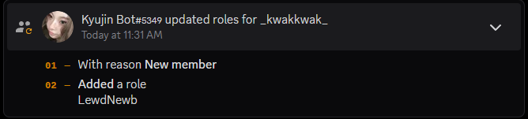

### 10. /rank reply
The rank commands assume every member holds the base rank role.

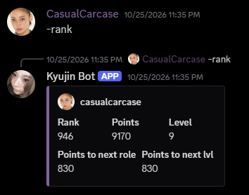

## Other

### 11. /role panel in #ping-roles
The slash-first design: the bot's commands are slash commands.

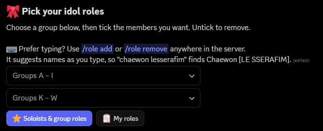

### 12. Developer Portal: Public Bot off, privacy policy linked

